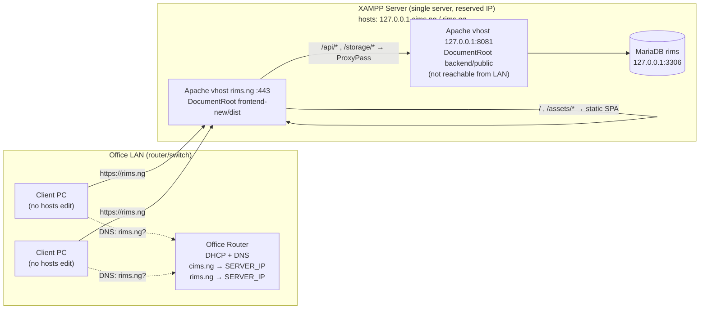

# RIMS – Office Intranet (LAN) Deployment Plan with Custom Domain `rims.ng`

- **Goal:** Make RIMS reachable on the office LAN as `https://rims.ng`, the same way CIMS is reachable as `https://cims.ng`. It must keep working with **no internet connection**.
- **Server:** the XAMPP machine that already hosts CIMS (`C:\xampp`, Apache 2.4 + PHP 8.2.12 + MariaDB).
- **Scope:** both RIMS applications. `backend/` is the Laravel 12 API and `frontend-new/` is the React 19 + Vite SPA. Both live in the `Colin-nwk/rims-dev` repository.

---

## 1. How CIMS was made to work with `cims.ng` (findings)

CIMS runs on **one server**, and every other PC reaches it over the office router/switch. There is no public domain and no cloud hosting. It works through two name overrides plus Apache virtual hosts:

| Layer                               | What CIMS does                                                                                                                                                                                            | Where                                                    |
| ----------------------------------- | --------------------------------------------------------------------------------------------------------------------------------------------------------------------------------------------------------- | -------------------------------------------------------- |
| **Name resolution (server)**  | The server's Windows `hosts` file maps `cims.ng` to itself: `127.0.0.1 cims.ng`. An older `10.46.142.121 cims.ng` line is also present.                                                           | `C:\Windows\System32\drivers\etc\hosts` on the server  |
| **Name resolution (clients)** | The **office router** holds a static DNS record `cims.ng → server LAN IP`. Client PCs get the router as their DNS server through DHCP, so **no client PC is edited**.                      | Router admin panel (static DNS / DNS host entries)       |
| **Apache listens on the LAN** | `Listen 0.0.0.0:80` and `Listen 0.0.0.0:443`. `mod_rewrite`, `mod_proxy`, `mod_proxy_http`, `mod_ssl`, and `mod_headers` are enabled.                                                       | `httpd.conf`, `extra/httpd-ssl.conf`                 |
| **Name-based vhosts**         | `<VirtualHost *:80>` and `<VirtualHost *:443>` both use `ServerName cims.ng`, with `DocumentRoot C:/xampp/htdocs/cims/public`. Each has its own log files.                                        | `extra/httpd-vhosts.conf`                              |
| **HTTPS**                     | A self-signed certificate with `CN=cims.ng` and SAN `cims.ng, *.cims.ng, localhost, 127.0.0.1`, valid until 2030. Clients must trust it.                                                              | `conf/ssl.crt/server.crt`, `conf/ssl.key/server.key` |
| **Old-path compatibility**    | The default `localhost` vhost redirects `http://<ip>/cims/...` to `https://cims.ng/...`. It also **reverse-proxies** `/cims/api/` to `http://cims.ng/api/` for hardware/biometric agents. | `extra/httpd-vhosts.conf`                              |
| **Laravel config**            | `APP_URL` and `ASSET_URL` are `https://cims.ng`. Also `SESSION_DOMAIN=cims.ng`, `SANCTUM_STATEFUL_DOMAINS=cims.ng`, and `SESSION_SECURE_COOKIE=false`.                                        | `cims/.env`                                            |
| **CORS / Sanctum**            | `cims.ng` is added to `allowed_origins` and to the Sanctum stateful list.                                                                                                                             | `config/cors.php`, `config/sanctum.php`              |
| **Frontend**                  | `URL="cims.ng/"` and `PROTOCOL="https://"` are hard-coded and compiled into the Vite build.                                                                                                           | `resources/js/utils/constants.ts`                      |

CIMS is simpler than RIMS because it is **one Laravel app** (Inertia + Vite build inside `public/`), so one vhost serves everything. RIMS has **two apps** (a Laravel API and a separate SPA), and that difference shapes the design below.

> [!WARNING]
> **The router's DNS record only works while the server keeps the same IP.** At the time of writing, the server's Wi-Fi adapter has `10.147.109.121`, while the server's `hosts` file still has an old `10.46.142.121 cims.ng` line. If the router record points at an old IP, every client loses CIMS. Reserve the server's IP on the router (Phase 1) so the CIMS and RIMS records never go stale.

---

## 2. RIMS today (findings)

| Item                      | Current state                                                                                              | LAN impact                                                                                             |
| ------------------------- | ---------------------------------------------------------------------------------------------------------- | ------------------------------------------------------------------------------------------------------ |
| Backend                   | Laravel 12, Sanctum **Bearer tokens** (`createToken`), routes under `/api/v1`                    | Tokens are stored in `localStorage`, so there are **no cookie or session-domain problems**     |
| Backend `.env`          | `APP_URL=http://localhost:8000`, `FRONTEND_URL=http://localhost:5173`, `APP_DEBUG=true`              | Must be changed for production                                                                         |
| Frontend API URL          | `VITE_API_URL=http://localhost:8000/api/v1`, compiled in at build time                                   | Must be changed and rebuilt                                                                            |
| File URLs                 | `getFileUrl()` builds `${VITE_API_URL minus /api/v1}/storage/...`                                      | Needs `/storage` reachable on the same base URL                                                      |
| Staff photo / certificate | `${VITE_API_URL}/staff/photo/...` and `${VITE_API_URL}/staff-education/{id}/certificate`               | These work through the same API base                                                                   |
| ID-card QR code           | Encodes `${window.location.origin}/staff/{service_no}`                                                   | Printed QR codes will contain `https://rims.ng/...` and **only resolve inside the office LAN** |
| `FilePreviewLink`       | Checks availability with a HEAD request only when the file is **same-origin**                        | The same-origin design below makes this work fully                                                     |
| Router                    | `BrowserRouter` (clean URLs)                                                                             | Apache needs an SPA fallback to `index.html`                                                         |
| CORS                      | `allowed_origins => ['*']` with `supports_credentials => true`                                         | Should be restricted                                                                                   |
| `public/storage` link   | **Missing**                                                                                          | `php artisan storage:link` is required                                                               |
| Mail                      | `smtp.gmail.com` (password-reset emails)                                                                 | **Fails without internet**, so a fallback is needed                                              |
| Queue                     | `QUEUE_CONNECTION=database`                                                                              | Queued notifications need a worker, or use `sync`                                                    |
| External assets           | No CDN or Google Fonts in the SPA. Only the unused Laravel `welcome.blade.php` loads `fonts.bunny.net` | Works offline                                                                                          |
| Hosting today             | Render.com (`.github/workflows/deploy.yml`, `allowedHosts: rims-dev.onrender.com`)                     | Cloud deploy can stay as is. LAN is a second target                                                    |

---

## 3. Target architecture (recommended): one domain plus an internal reverse proxy

This follows the CIMS pattern of one domain per system and uses Apache `ProxyPass` the same way CIMS already does. The browser only ever talks to **`https://rims.ng`**:



**Why this design:**

- **Same setup effort as CIMS:** add one DNS record on the router, one `hosts` line on the server, and use one certificate. **No client PC needs editing for name resolution.**
- **Same origin for the SPA and the API**, so there is no CORS, no mixed content, and no second certificate prompt. `FilePreviewLink` and html2canvas photo capture work without CORS workarounds.
- **The Laravel backend and `.env` are never exposed to the LAN.** Only Apache on `127.0.0.1:8081` can reach them.
- The frontend can use a **relative** API URL (`/api/v1`). The same build then works at `https://rims.ng`, at the server IP, or after a future domain change.

<details>
<summary>Alternative considered: two hostnames (<code>rims.ng</code> + <code>api.rims.ng</code>)</summary>

Each repo would get its own vhost, like CIMS's single vhost. This needs no proxy, but it has drawbacks:

- 2 router DNS records and 2 certificate names to maintain.
- Cross-origin XHR fails **silently** if a user has not trusted `api.rims.ng` (they never visit it directly).
- CORS has to be maintained, and `FilePreviewLink` skips its same-origin check.

Use it only if the backend must also be called directly by other LAN systems.

</details>

---

## 4. Implementation plan

### Phase 1: Server network prerequisites (one-time)

1. **Reserve the server's IP on the router** (DHCP reservation by MAC address). Use the same IP the router's `cims.ng` record already points to, so CIMS and RIMS share one `SERVER_IP`. Prefer **wired Ethernet** to the switch over Wi-Fi, because Wi-Fi and Ethernet adapters have different MAC addresses and therefore different reservations.
2. **Set the Windows network profile to Private**: Settings → Network → *Private network*.
3. **Firewall:** open only ports 80 and 443. Run this in PowerShell as Administrator:
   ```powershell
   New-NetFirewallRule -DisplayName "Intranet Apache HTTP/HTTPS" -Direction Inbound `
     -Protocol TCP -LocalPort 80,443 -Action Allow -Profile Private,Domain
   ```

   Do **not** open 8081 (internal API) or 3306 (MariaDB).
4. Confirm that MariaDB is bound to `127.0.0.1` (`bind-address` in `C:\xampp\mysql\bin\my.ini`).
5. Housekeeping: remove the stale `10.46.142.121 cims.ng` line from the **server's** `hosts` file. Only `127.0.0.1 cims.ng` is needed there.

### Phase 2: Name resolution for `rims.ng` (same as CIMS)

Two places change, exactly mirroring CIMS. **Client PCs are not touched.**

**2.1 Server: Windows `hosts` file.** This lets the server open `rims.ng` locally without depending on the router. Run as Administrator:

```powershell
Add-Content "$env:windir\System32\drivers\etc\hosts" "`r`n127.0.0.1`trims.ng"
ipconfig /flushdns
```

**2.2 Router: static DNS record for the clients.** In the router admin panel, open the same page where the `cims.ng` record is defined. Depending on the model it is called *DNS → Static*, *DNS Host Entries*, *Local DNS*, or *DNS Rebind/Hosts*. Add a record next to it:

| Hostname        | IP                            |
| --------------- | ----------------------------- |
| `cims.ng`     | `SERVER_IP` (existing)      |
| `rims.ng`     | `SERVER_IP` (**new**) |
| `www.rims.ng` | `SERVER_IP` (optional)      |

**2.3 Requirements on the router side** (already true if CIMS works on the clients):

- The router's DHCP must hand out **the router itself** as the DNS server. If DHCP hands out `8.8.8.8` or an ISP DNS, clients bypass the record.
- The router's DNS forwarder must answer local records **even when the internet uplink is down**. Test this with the "unplug the internet" item in the verification checklist (section 6).
- Some routers have DNS-rebind protection that blocks public names from resolving to private IPs. If `rims.ng` doesn't resolve on clients, whitelist `rims.ng` (and `cims.ng`) there.

**2.4 Test from any client:** run `nslookup rims.ng` and `ping rims.ng`. Both should return `SERVER_IP`. If a client still gets the old answer, run `ipconfig /flushdns` on it, or renew its lease with `ipconfig /release && ipconfig /renew`.

> [!NOTE]
> `.ng` is a real public top-level domain. The router record wins inside the office, but laptops taken outside will resolve the public `rims.ng` if someone registers it. This is the same trade-off CIMS already accepts. `rims.internal` (`.internal` is reserved by ICANN for private networks) is a collision-free alternative if you ever want one.

### Phase 3: HTTPS certificate (local office CA)

CIMS uses a self-signed leaf certificate, which means every browser shows a warning unless that exact certificate is trusted. A cleaner approach is to create **one office root CA**, install it once per PC, and issue certificates for `rims.ng` (and later re-issue `cims.ng`) from it.

> [!NOTE]
> The router handles **names** only. Certificate trust lives in each PC's Windows certificate store, so the router cannot do this step. It is the only per-client action left, and it is optional if RIMS runs on HTTP.

Run in `cmd` as Administrator using XAMPP's OpenSSL:

```bat
cd /d C:\xampp\apache
set OPENSSL_CONF=C:\xampp\apache\conf\openssl.cnf

:: 1) Office root CA (do once, keep office-ca.key safe/offline)
bin\openssl req -x509 -newkey rsa:4096 -sha256 -days 3650 -nodes ^
  -keyout conf\ssl.key\office-ca.key -out conf\ssl.crt\office-ca.crt ^
  -subj "/C=NG/ST=FCT/L=ABUJA/O=Corrections/OU=ICT/CN=NCoS Office Intranet CA"

:: 2) rims.ng key + CSR
bin\openssl req -newkey rsa:2048 -nodes -keyout conf\ssl.key\rims.key -out conf\rims.csr ^
  -subj "/C=NG/ST=FCT/L=ABUJA/O=Corrections/OU=ICT/CN=rims.ng"

:: 3) Sign it with SANs
(echo basicConstraints=CA:FALSE& echo keyUsage=digitalSignature,keyEncipherment& echo extendedKeyUsage=serverAuth& echo subjectAltName=DNS:rims.ng,DNS:www.rims.ng) > conf\rims.ext
bin\openssl x509 -req -in conf\rims.csr -CA conf\ssl.crt\office-ca.crt -CAkey conf\ssl.key\office-ca.key ^
  -CAcreateserial -out conf\ssl.crt\rims.crt -days 825 -sha256 -extfile conf\rims.ext
```

**Trust the CA on every PC.** Copy `office-ca.crt` from a USB stick or a shared folder, then run as Administrator:

```bat
certutil -addstore -f Root office-ca.crt
```

- Firefox: set `security.enterprise_roots.enabled = true` in `about:config`, or import the CA in Firefox settings.
- Domain-joined PCs: push the CA through Group Policy instead.

> [!TIP]
> Optional follow-up: re-issue `cims.ng` from the same CA (the same step 2–3 with `cims.ng` SANs), then point the CIMS vhost at it. One trusted CA then covers both systems and the old warnings go away.

*Fallback:* if you cannot install the CA on PCs yet, run RIMS over HTTP first (Phase 4 note). Bearer-token auth works over HTTP, but LAN traffic is not encrypted.

### Phase 4: Apache virtual hosts

Append to `C:\xampp\apache\conf\extra\httpd-vhosts.conf`:

```apache
# ───────────── RIMS: internal backend (Laravel API) – localhost only ─────────────
Listen 127.0.0.1:8081
<VirtualHost 127.0.0.1:8081>
    ServerName rims-api.internal
    DocumentRoot "C:/xampp/htdocs/rims/backend/public"
    <Directory "C:/xampp/htdocs/rims/backend/public">
        Options -Indexes +FollowSymLinks
        AllowOverride All
        Require local
    </Directory>
    ErrorLog  "logs/rims-api-error.log"
    CustomLog "logs/rims-api-access.log" combined
</VirtualHost>

# ───────────── RIMS: public entry on the LAN ─────────────
<VirtualHost *:80>
    ServerName rims.ng
    ServerAlias www.rims.ng
    Redirect permanent / https://rims.ng/
</VirtualHost>

<VirtualHost *:443>
    ServerName rims.ng
    ServerAlias www.rims.ng
    DocumentRoot "C:/xampp/htdocs/rims/frontend-new/dist"

    SSLEngine on
    SSLCertificateFile    "conf/ssl.crt/rims.crt"
    SSLCertificateKeyFile "conf/ssl.key/rims.key"

    # API + uploaded files → internal Laravel vhost (same origin for the browser)
    ProxyRequests Off
    ProxyPreserveHost On
    RequestHeader set X-Forwarded-Proto "https"
    ProxyPass        /api/     http://127.0.0.1:8081/api/
    ProxyPassReverse /api/     http://127.0.0.1:8081/api/
    ProxyPass        /storage/ http://127.0.0.1:8081/storage/
    ProxyPassReverse /storage/ http://127.0.0.1:8081/storage/
    ProxyPass        /up       http://127.0.0.1:8081/up

    <Directory "C:/xampp/htdocs/rims/frontend-new/dist">
        Options -Indexes
        AllowOverride None
        Require all granted
        # React BrowserRouter: unknown paths → index.html
        FallbackResource /index.html
    </Directory>

    # Hashed build assets can be cached; index.html must not be (so updates show immediately)
    <LocationMatch "^/assets/">
        Header set Cache-Control "public, max-age=31536000, immutable"
    </LocationMatch>
    <Files "index.html">
        Header set Cache-Control "no-cache"
    </Files>

    ErrorLog  "logs/rims-ssl-error.log"
    CustomLog "logs/rims-ssl-access.log" combined
</VirtualHost>
```

**Harden the existing default `localhost` vhost.** This vhost answers every request made by IP address, like `http://SERVER_IP/...`. Without this change, a LAN user could open `http://SERVER_IP/rims/backend/.env` and read the database password and `APP_KEY`. Add the following inside the first `<VirtualHost *:80>` (the `ServerName localhost` one), next to the CIMS redirects:

```apache
    RedirectMatch 302 ^/rims(/.*)?$ https://rims.ng/
    <Directory "C:/xampp/htdocs/rims">
        Require all denied
    </Directory>
```

Then validate and restart:

```bat
C:\xampp\apache\bin\httpd.exe -t
:: then Stop/Start Apache in the XAMPP Control Panel (or restart the Apache service)
```

> **HTTP-only fallback:** put the `DocumentRoot`, the `ProxyPass` lines, and the `<Directory>` block in the `:80` vhost instead of the `Redirect`. Remove `RequestHeader set X-Forwarded-Proto`. Use `http://` in the `.env` URLs.

### Phase 5: Backend changes (`backend/`)

**5.1 Production `.env`.** Keep the secrets you already have and change these values:

```dotenv
APP_NAME=RIMS
APP_ENV=production
APP_DEBUG=false
APP_URL=https://rims.ng
FRONTEND_URL=https://rims.ng          # used in password-reset links
LOG_LEVEL=warning

SESSION_DOMAIN=null
SANCTUM_STATEFUL_DOMAINS=rims.ng

DB_HOST=127.0.0.1
DB_DATABASE=rims

# Offline-safe defaults
QUEUE_CONNECTION=sync                  # or keep "database" and run a worker (5.5)
MAIL_MAILER=log                        # until a LAN SMTP server exists (see 5.6)
```

**5.2 Trust the local proxy** so Laravel generates `https://rims.ng/...` URLs. Edit `bootstrap/app.php`:

```php
->withMiddleware(function (Middleware $middleware): void {
    $middleware->trustProxies(at: '127.0.0.1');
    $middleware->append([
        \Illuminate\Http\Middleware\HandleCors::class,
    ]);
})
```

**5.3 Restrict CORS** in `config/cors.php`. With the same-origin setup the browser does not need CORS, so only dev and cloud origins remain:

```php
'allowed_origins' => array_filter(explode(',', env('CORS_ALLOWED_ORIGINS', 'https://rims.ng'))),
'allowed_origins_patterns' => ['#^http://(localhost|127\.0\.0\.1)(:\d+)?$#'],
```

Add `CORS_ALLOWED_ORIGINS=https://rims.ng` to the LAN `.env`. Set the Render frontend URL in the cloud `.env`.

**5.4 Token lifetime (optional, matches CIMS's `SANCTUM_EXPIRATION=480`).** In `config/sanctum.php`, set `'expiration' => env('SANCTUM_EXPIRATION')`, then add `SANCTUM_EXPIRATION=480` to `.env`.

**5.5 Queue (only if `QUEUE_CONNECTION=database`).** Run `php artisan queue:work --tries=3` as a Windows service (with NSSM) or as a Task Scheduler task that starts at boot. Otherwise queued notifications such as password reset are never sent.

**5.6 Email without internet.** Password reset currently depends on Gmail SMTP. Pick one:

- (a) `MAIL_MAILER=log` and let an admin reset passwords from the user-management screen (simplest).
- (b) Install a LAN mail server (for example hMailServer) and point `MAIL_HOST` at it.
- (c) Keep Gmail and accept that resets only work while the internet is up.

Reset links will contain `https://rims.ng/...`, which only open inside the office.

**5.7 Deploy commands** (in `C:\xampp\htdocs\rims\backend`; run the terminal **as Administrator** for `storage:link`):

```bat
C:\xampp\php\php.exe artisan key:generate        :: first install only, if APP_KEY empty
C:\xampp\php\php.exe artisan migrate --force
C:\xampp\php\php.exe artisan storage:link         :: creates public\storage (currently missing)
C:\xampp\php\php.exe artisan optimize             :: config/route/view cache
```

- Seed staff data the first time with `seed-staff-data-production.bat`, or import `rims_db.sql`.
- `composer install --no-dev --optimize-autoloader` needs internet. Run it on a connected machine and copy `vendor/` if the server is offline.
- Check `C:\xampp\php\php.ini`. Currently `upload_max_filesize` and `post_max_size` are 40M, which is enough for photos and certificates. Raise them only if needed.

### Phase 6: Frontend changes (`frontend-new/`)

**6.1 Production env.** Create `frontend-new/.env.production`:

```dotenv
VITE_API_URL=/api/v1
```

A relative URL works with this code:

- `apiClient` uses it as the axios `baseURL`.
- `getFileUrl()` turns it into `/storage/...`.
- `StaffIDCard` turns it into `/api/v1/staff/photo/...`.
- `staffEducationService` turns it into `/api/v1/staff-education/{id}/certificate`.

All of these resolve against whatever host the user opened. Keep `.env` (localhost:8000) for development.

> If you prefer an absolute URL, use `VITE_API_URL=https://rims.ng/api/v1`. The build is then tied to that hostname.

**6.2 Build** (needs internet only for `npm ci`; `npm run build` itself is offline):

```bat
cd C:\xampp\htdocs\rims\frontend-new
npm ci
npm run build          :: outputs frontend-new\dist  (Apache serves this folder)
```

**6.3 No other code changes are required.** Things that were checked:

- There are no CDN, Google Fonts, or other external runtime URLs.
- The 401 redirect to `/staff-login` is relative.
- The QR code uses `window.location.origin`.
- `vite.config.ts` `preview.allowedHosts` only matters for `vite preview` (Render), not for Apache.

### Phase 7: Client PC rollout

Name resolution needs **nothing on the client**, because the router record from Phase 2.2 covers every PC on the switch. Per PC:

1. Check that the PC uses the router for DNS: `nslookup rims.ng` returns `SERVER_IP`.
2. Only if you use HTTPS with the office CA: import `office-ca.crt` into Trusted Root (Phase 3). Do this once per PC (about 1 minute), or push it through Group Policy if the PCs are domain-joined.
3. Open `https://rims.ng`. It should show a padlock, no warning, and the RIMS login page.
4. Create a desktop or bookmark shortcut to `https://rims.ng`.

### Phase 8: Operations (offline-first)

- **Updates:** when internet is available, run `git pull` on the server, then:

  - Backend: `composer install --no-dev -o` (if needed), `migrate --force`, `optimize`.
  - Frontend: `npm ci && npm run build`.

  If there is no internet, build on a connected machine and copy `backend/` (with `vendor/`) and `frontend-new/dist/` over USB. Never run `migrate:fresh` in production.
- **Backups:** schedule a daily `mysqldump rims` plus a zip of `backend/storage/app/public` to a second disk or USB, the same idea as CIMS's weekly backup job.
- **Logs:** `C:\xampp\apache\logs\rims-*.log` and `backend\storage\logs\laravel.log`.
- **Apache and MariaDB as services:** in the XAMPP Control Panel, tick *Svc* for both so RIMS comes back after a reboot without anyone logging in.

---

## 5. Summary of file changes

| File                                                              | Change                                                                                                                   |
| ----------------------------------------------------------------- | ------------------------------------------------------------------------------------------------------------------------ |
| `C:\Windows\System32\drivers\etc\hosts` (**server only**) | `127.0.0.1 rims.ng`. Also remove the stale `10.46.142.121 cims.ng` line                                              |
| **Office router** (static DNS / DHCP)                       | New record `rims.ng → SERVER_IP` next to `cims.ng`. DHCP reservation for the server                                 |
| `C:\xampp\apache\conf\extra\httpd-vhosts.conf`                  | New internal `127.0.0.1:8081` vhost, `rims.ng` :80 and :443 vhosts, `/rims` deny and redirect in the default vhost |
| `C:\xampp\apache\conf\ssl.crt\` and `ssl.key\`                | `office-ca.*` and `rims.crt` / `rims.key`                                                                          |
| `rims/backend/.env`                                             | Production URLs, debug off, offline mail and queue                                                                       |
| `rims/backend/bootstrap/app.php`                                | `trustProxies(at: '127.0.0.1')`                                                                                        |
| `rims/backend/config/cors.php`                                  | Env-driven allowed origins instead of `*`                                                                              |
| `rims/backend/config/sanctum.php`                               | (optional) `expiration` from env                                                                                       |
| `rims/frontend-new/.env.production`                             | `VITE_API_URL=/api/v1`                                                                                                 |

---

## 6. Verification checklist

- [ ] `httpd -t` returns `Syntax OK`, and Apache restarts cleanly.
- [ ] On the server: `https://rims.ng` loads the SPA, and `https://rims.ng/up` returns 200.
- [ ] From a client PC: `nslookup rims.ng` returns `SERVER_IP` **from the router**, and `https://rims.ng` shows a padlock.
- [ ] Login works. DevTools → Network shows API calls to `https://rims.ng/api/v1/...` (no CORS errors, no mixed content).
- [ ] Deep link or refresh on an inner page (for example `/staff/...`) loads instead of returning 404, which confirms the SPA fallback.
- [ ] Photo upload and display (`/storage/...`) work, and certificate view and ID-card photo work.
- [ ] Generate an ID card and scan its QR code with a phone **on office Wi-Fi** that resolves `rims.ng`.
- [ ] Return 403 or a redirect, never a file: `http://SERVER_IP/rims/backend/.env`, `http://SERVER_IP:8081/`, and port 3306 from a client.
- [ ] Unplug the internet uplink: RIMS (and CIMS) still work end to end.
- [ ] Reboot the server: Apache and MariaDB come back up, and RIMS is reachable.
- [ ] CIMS still works (`https://cims.ng`), with no regression from the vhost edits.

---

## 7. Risks and mitigations

| Risk                                                                | Mitigation                                                                                                                                      |
| ------------------------------------------------------------------- | ----------------------------------------------------------------------------------------------------------------------------------------------- |
| Server IP changes, so the router DNS record goes stale              | DHCP reservation for the server's MAC on the router. Wired Ethernet                                                                             |
| Clients bypass the router DNS (for example, a manually set 8.8.8.8) | DHCP hands out the router as DNS. Fix any manually configured adapters                                                                          |
| Router can't resolve local records while the internet is down       | Verify with the uplink unplugged. If it fails, run a small DNS server on the server machine (for example Technitium) and hand that out via DHCP |
| Browser certificate warnings or failed API calls                    | Install the office CA on every PC. The single-origin design means only one name to trust                                                        |
| Password-reset email fails offline                                  | `MAIL_MAILER=log` plus admin-driven resets, or a LAN SMTP server                                                                              |
| `.env` exposed via `http://IP/rims/...`                         | Deny and redirect in the default vhost. Backend only on `127.0.0.1:8081`                                                                      |
| Printed QR codes don't work off-site                                | Expected for an intranet. Document it for users                                                                                                 |
| Public `rims.ng` registered by someone else                       | The router record wins inside the office. Use `rims.internal` if needed                                                                       |
| Offline updates                                                     | Build artifacts (`vendor/`, `dist/`) on a connected machine and transfer over USB                                                           |
